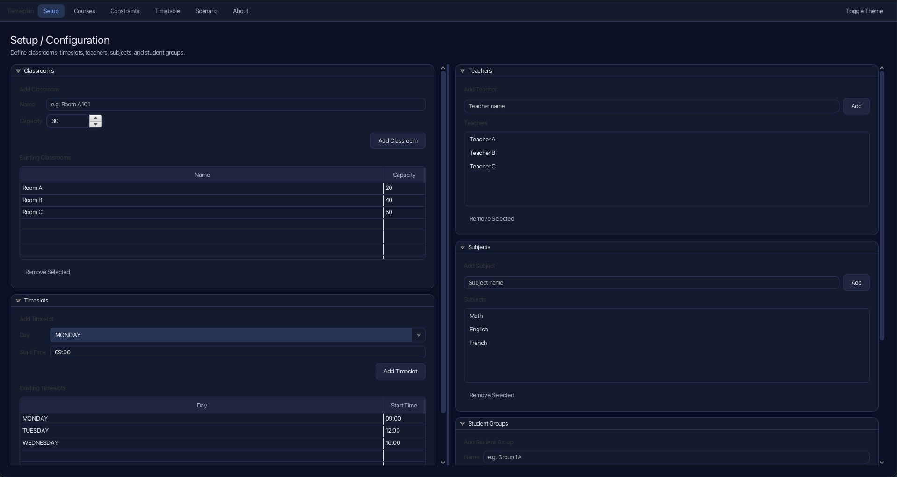
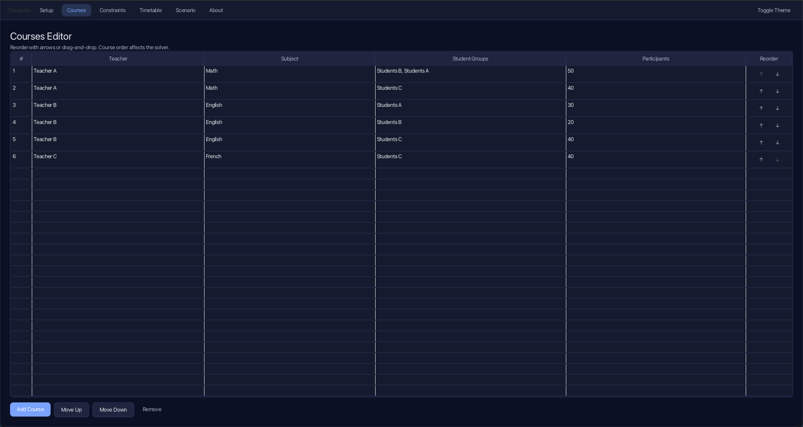

# TiemePlan

[](https://opensource.org/licenses/Apache-2.0)

[](https://github.com/JoranVanBelle/tiemeplan/actions/workflows/ci.yml)


**School timetables, simplified.**

Tiemeplan, inspired by the Norwegian word *timeplan* (schedule), is an open-source application for generating school timetables.
Built with Java and JavaFX, it helps schools organize teachers, students, subjects and classrooms, and generate schedules for each.


## How it works

### 1. Configure your school
Set up your teachers, students, subjects and classrooms.


### 2. Create a course overview
Organise your courses using the configured school data.


### 3. Generate and export timetables
Generate individual schedules for teachers, student groups and classrooms.


## Features

- **Constraint-based generation** – Generate timetables based on configurable scheduling constraints.
- **Individual timetables** – Export timetables for teachers, students and classrooms.
- **Multiple export formats** – Export timetables as PDF, CSV and PNG.
- **Cross-platform** – Available for Windows, macOS and Linux.
- **Standalone application** – No Java installation required.

## Downloads

Download the latest release from the [releases page](https://github.com/JoranVanBelle/tiemeplan/releases).

| Platform              | Download                               | How to run                                                                                               |
|-----------------------|----------------------------------------|----------------------------------------------------------------------------------------------------------|
| Linux (x64)           | `Tiemeplan-<version>-linux-x64.tar.gz` | Extract anywhere and run `Tiemeplan/bin/Tiemeplan` (requires GTK 3, present on any desktop distribution) |
| Windows (x64)         | `Tiemeplan-<version>-windows-x64.zip`  | Unzip anywhere and run `Tiemeplan\Tiemeplan.exe`                                                         |
| macOS (Apple silicon) | `Tiemeplan-<version>-macos-arm64.zip`  | Unzip and move `Tiemeplan.app` to Applications                                                           |

## Platform notes

- **Linux**: GTK 3 is required and is available on most desktop distributions.
- **Windows**: No additional runtime requirements.
- **macOS**: Currently supports Apple Silicon (ARM64).

## Unsigned releases

The Windows and macOS downloads are not signed yet:

- Windows shows a SmartScreen warning: choose **More info** and then **Run anyway**.
- macOS blocks the first start: open **System Settings > Privacy & Security** and choose **Open Anyway**,
  or run `xattr -dr com.apple.quarantine Tiemeplan.app`.

## Building from source

### Prerequisites

- JDK 26
- Git

### Build

Clone the repository
```bash
git clone https://github.com/JoranVanBelle/tiemeplan.git
```

Build the application
```bash
./mvnw clean package -Papp-image
```

The application image is generated in 
```bash
target/app-image/dist
```

## Contributing

Contributions are welcome!

If you have any suggestions, issues, or want to contribute to the project, please open an issue or submit a pull request.

Before submitting a pull request, please make sure that:

- Your changes build successfully.
- Existing tests pass.
- Your changes are appropriately documented.

For more information, see [CONTRIBUTING.md](CONTRIBUTING.md).

## Technology stack
- Java 26
- JavaFX
- Maven
- JPackage

## License

TiemePlan is licensed under the [Apache License 2.0](https://www.apache.org/licenses/LICENSE-2.0).

You are free to use, modify and distribute this software under the terms of the license.
See the [LICENSE](LICENSE) file for the full license text.